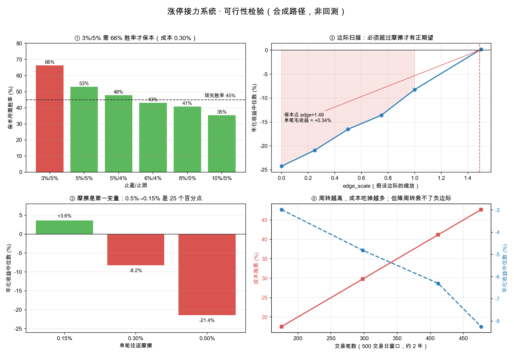

# 组合可行性验证报告 v0.1

> 配套文档：`01_系统设计_v0.1.md`
> 复现方式：`cd feasibility && python3 checks.py && python3 scenarios.py --n-paths 1500 --days 500`
> **本报告没有使用任何行情数据。** 全部结论来自三类检验：结构分析、算术推导、合成路径压力测试。

---

## 0. 结论先行

| 维度 | 判定 | 一句话理由 |
|---|---|---|
| **结构可行性** | ✅ 通过 | 五类规则冲突全部消除，分层与优先级可编码 |
| **数据可行性** | ⚠️ 有条件通过 | 最低可行档是「日线 + 竞价快照」；缺分时则 E2 必须停用 |
| **算术可行性** | ✅ 通过（门槛明确） | 保本需单笔毛收益 **+0.34%**；做 25% 年化需 **+1.2%** |
| **成本可行性** | ❌ 最大风险 | 摩擦从 0.5% 降到 0.15%，年化从 **−21.4%** 变成 **+3.6%** |
| **统计可行性** | ❌ 不通过 | 22 个参数需 **660 笔**样本，按 84 笔/年需 **7.9 年** |
| **组合生存性** | ⚠️ 脆弱 | 3 槽位下回撤 >30% 的概率 **72.9%**，5 槽位降到 47.1% |

**一句话**：这套组合在结构上站得住，但它是一门**"摩擦必须极低、单笔边际必须够厚"**的生意。
在 0.30% 摩擦 + 477 笔/年的高周转下，它数学上必亏；把周转压到 84 笔/年、摩擦压到 0.15%，它才刚回到盈亏线上方。

---

## 1. 方法与边界

| 检验 | 做什么 | 不能证明什么 |
|---|---|---|
| **F1 结构一致性** | 枚举规则两两关系，检查是否可同时成立 | 不能证明规则有效 |
| **F2 数据可行性** | 每条规则需要什么字段，分档看哪些能跑 | 不能证明数据质量 |
| **F3 保本胜率** | 由止盈/止损/成本反解胜率门槛 | 不能给出真实胜率 |
| **F4 凯利检验** | 判断仓位是"分散"还是"满凯利" | 不能替代风险偏好 |
| **F5 成本预算** | 周转率 × 摩擦 = 年化拖累 | 不能给出真实滑点 |
| **F6 自由度预算** | 参数个数 vs 可用样本 | 不能说明参数选得对不对 |
| **F7 状态机驻留** | 转移矩阵 → 平均驻留天数 | 不能验证状态定义正确 |
| **F8 合成路径压力测试** | 给定边际假设，看组合能否存活 | **不是回测，不能预测收益** |

> 为什么不做回测：参数还在自相矛盾时做回测，得到的只是一个拟合噪声的数字。先证伪结构，再谈收益。

---

## 2. 检验结果总表

| # | 检验项 | 结论 | 关键数字 |
|---|---|---|---|
| F1 | 规则冲突消解 | ✅ | 5 类冲突 → 5 条消解规则（§3） |
| F2 | 数据可得性 | ⚠️ | 3 档数据 → 可运行引擎 0 / 2 / 3 个（§4） |
| F3 | 保本胜率 | ✅ 但揭示问题 | 原文 3%/5% 需 **66.3%**；改 8%/5% 降至 **40.8%**（§5） |
| F4 | 凯利仓位 | ❌ 原设计超配 | 33% 单票需胜率 **60.5%**（8/5 结构）或 **77.5%**（原文 3/5 结构）（§6） |
| F5 | 成本预算 | ❌ 高周转不可行 | 477 笔/年 → 成本拖累 **47.7%**（§7） |
| F6 | 自由度预算 | ❌ 样本不足 | 22 参数 × 30 笔 = **660 笔** ≈ 7.9 年（§8） |
| F7 | 状态机驻留 | ✅ | 建议矩阵平均驻留 **4.3 天**（§9） |
| F8 | 组合生存性 | ⚠️ | 保本单笔毛收益 **+0.34%**（§10） |



> 图①②：盈亏结构与边际门槛；图③：摩擦是第一变量；图④：周转提高成本，但降周转救不了负边际。

---

## 3. F1 结构一致性：五类冲突怎么消解

| 冲突 | 原文问题 | 消解规则 | 可验证方式 |
|---|---|---|---|
| **X1** 打板/低吸/半路 | 三种买点并列 | 引擎由**市场状态**单向选择，盘中不可改 | 每日 `active_engine` 唯一 |
| **X2** 快止盈 vs 拿住加速 | 直接矛盾 | 退出梯度按**持仓状态**分支 | `HELD_ACCEL` 状态下不存在固定 TP |
| **X3** 两种"分歧" | 同词反向 | `DIVERGE` 专指市场状态；个股分歧只作持仓标签 | 命名空间隔离 |
| **X4** 龙头 vs 低位首板 | 争抢槽位 | `max_board ≥ 6` 时禁买中间身位 | 高低切闸门 |
| **X5** 三只分仓 vs 主线集中 | 伪分散 | 同题材 ≤ 2 只 | 组合约束断言 |

**单调收缩不变量（可直接写成代码断言）**：

```
I1  weight_i   <= min(state_cap, 1/slots, engine_cap)
I2  allowed_engines ⊆ state_engines[regime]          # 只能关，不能开
I3  stop_price 单调不减                               # 止损只能上移
I4  excluded_by_L0 ∩ order_set = ∅                    # 被剔除的不能复活
I5  ∀ engine pair: hold_stocks(e1) ∩ hold_stocks(e2) = ∅
```

> F1 的结论不是"设计正确"，而是"设计**可被证伪**"——这比正确更重要。

---

## 4. F2 数据可行性：三档数据能跑多少

| 数据档 | 内容 | 可运行的引擎 | 覆盖率 |
|---|---|---|---|
| **T0** | 日线（OHLCV）+ 涨跌停 + 板块 | **0 个完整引擎** | ~45% |
| **T1** | T0 + **集合竞价快照**（9:25 开盘价、竞价量额） | E1（竞价分支）、E3 | ~70% |
| **T2** | T1 + **分时/逐笔**（封板时刻、封单、开板次数） | E1、E2、E3 全部 | 100% |

### 各层的数据依赖

| 层 | T0 够吗 | 缺什么会失效 |
|---|---|---|
| L0 制度 | ✅ | — |
| L1 状态 | ✅ | — |
| L2 主线 | ✅ | 需要板块成分表 |
| L3 身位 | ⚠️ | `board_count` 够；**封板时刻/封单额要 T2**，否则 `identity` 退化为纯连板高度 |
| L4-E1 | ⚠️ | 弱转强分支需分时；次日竞价分支只需 T1 |
| L4-E2 | ❌ | **"30 分钟不创新低 + 站上均价"没有日线替代品** |
| L4-E3 | ⚠️ | 竞价量需要 T1 |
| L5 持仓态 | ⚠️ | `ACCEL` 判定需"一字/秒板"识别 → T2 |
| L6 退出 | ✅ | — |
| L7/L8 | ✅ | — |

### 结论（对应设计文档 O3）

> **没有分时数据 = 没有 E2。**
> 用日线去近似"分时止跌回升"（例如"次日收阳"），等于用收盘后才知道的信息做决策，
> 回测会漂亮，实盘完全无法执行。这叫**未来函数**，不是简化。

**最低可行档是 T1。** 只有 T0 时，整套系统会退化成一个与原文打法无关的低频日线策略。

---

## 5. F3 保本胜率：原文参数的核心问题

成本按 A 股现行费率：佣金 0.025%×2 + 印花税 0.05%（卖出）+ 过户费 0.001%×2 + 滑点 0.10%×2 ≈ **0.30% 往返**。

| 止盈 | 止损 | 盈亏比 | **保本胜率** | 期望@45%胜率 | 期望@55%胜率 |
|---|---|---|---|---|---|
| **3%** | **5%** | 0.51 | **66.3%** | **−1.70%** | −0.90% |
| 5% | 5% | 0.89 | 53.0% | −0.80% | +0.20% |
| 5% | 4% | 1.09 | 47.8% | −0.25% | +0.65% |
| 6% | 4% | 1.32 | 43.0% | +0.20% | +1.20% |
| **8%** | **5%** | 1.45 | **40.8%** | **+0.55%** | +1.85% |
| 10% | 5% | 1.83 | 35.3% | +1.45% | +2.95% |

### T+1 会进一步抬高门槛

名义止盈拿不到手——当日买入不能卖，次日跳空会截断目标：

| 名义止盈捕获率 | 8%/5% 保本 | 3%/5% 保本 |
|---|---|---|
| 100% | 40.8% | 66.3% |
| 90% | 43.5% | 68.9% |
| 80% | 46.5% | **71.6%** |

**小止盈被 T+1 折损得最厉害。** 3% 的目标实际只能拿到 2.4–2.7%，保本线被推到 69–72%——比原文声称的 70% 胜率还要高。

### 成本敏感性

| 单笔摩擦 | 8%/5% 保本胜率 |
|---|---|
| 0.15% | 40.0% |
| 0.30% | 40.8% |
| 0.50% | 42.3% |

> 结论：**原文"3–5% 快兑现"在 T+1 制度下是自伤。** v0.1 把 E1 改成 8%/5%，把保本线从 66% 压到 41%。
> 这不是优化，是**把系统从"必须靠 70% 胜率才能活"改成"45% 胜率也能活"**。

---

## 6. F4 凯利检验：3:3:3 到底是什么

单票 33% 仓位对应的凯利比例：

| 止盈/止损 | 保本胜率 | f*@45% | f*@55% | f*@70% | **33% 仓位所需胜率** |
|---|---|---|---|---|---|
| 3%/5% | 66.3% | −63.1% | −33.4% | +11.0% | **77.5%** |
| 5%/5% | 53.0% | −17.1% | +4.2% | +36.1% | 68.7% |
| 6%/4% | 43.0% | +3.5% | +21.0% | +47.3% | 62.0% |
| **8%/5%** | 40.8% | +7.1% | +24.0% | +49.3% | **60.5%** |

### 这是本报告最反直觉的发现

原文「3%/5% + 70% 胜率」这一组假设：

- 保本需要 66.3% 胜率 ✔（作者说 70%，有 3.7 个点的余量）
- 70% 胜率下，单笔凯利 f\* = **11.0%**

**也就是说，作者"70% 胜率 + 3%/5%"的假设是内在自洽的**——它确实能赚钱，但它只支持 **11%** 的单笔仓位。

**问题出在 3:3:3**：单票 33% 是 11% 的 **3 倍**。要让 33% 恰好等于满凯利，胜率必须到 **77.5%**——比作者自己说的 70% 还高 7.5 个点。

> 所以 3:3:3 不是"分散风险"，而是"把满凯利再放大三倍"。
> 这也解释了原文为什么反复强调"心态第一、纪律第二"——**在这个仓位下，波动必然是剧烈的，不靠纪律根本拿不住。**

### 对设计的影响

| 实测胜率（滚动 60 笔） | 单票上限 | 满仓槽位数 |
|---|---|---|
| ≥ 60% | 33% | 3 |
| 50–60% | 25% | 4 |
| 40–50% | 20% | 5 |
| < 40% | 停用该引擎 | — |

> **仓位不该是设定值，应该是测量值。** 这是 v0.1 相对原文最重要的改动之一。

---

## 7. F5 成本预算：周转率的隐形上限

年化成本拖累 = 年笔数 × 单票权重(1/3) × 单笔摩擦(0.30%)

| 年交易笔数 | 成本拖累 | 占 25% 目标年化 |
|---|---|---|
| 50 | 5.0% | 20% |
| **83** | **8.3%** | **33%** |
| 100 | 10.1% | 40% |
| 150 | 15.1% | 60% |
| 200 | 20.1% | 81% |
| 300 | 30.2% | **121%** |

### 原文复利论证的漏洞

> 原文："10 天做 10 个 3% 的股，比 10 天赚 30% 的股利润更大，因为有复利。"（1.03^10 = 1.344）

这个算式漏了摩擦。加上 0.30% 往返：

```
10 次 × 3% 净 2.7%  →  1.027^10 = 1.305  <  1.30（一次性 30%）
10 次 × 5% 净 4.7%  →  1.047^10 = 1.582  >  1.30  ✔
```

**结论：只有单笔边际足够厚（≥5%）时，高周转的复利才成立。** 3% 的小止盈在 T+1 + 0.3% 摩擦下，复利反而是负贡献。

> 这条验证直接推翻了 S18 的"高胜率小止盈 + 高周转"路径，也是 §5 把 E1 止盈改成 8% 的第二个理由。

---

## 8. F6 自由度预算：诚实的"不通过"

| 项 | 数值 |
|---|---|
| 参数总数 | 37 |
| 其中可调 | **22** |
| 冻结 | 15 |
| 按每参数 30 笔样本 | **660 笔** |
| 按 84 笔/年（设计目标） | **7.9 年** |
| 按 150 笔/年 | 4.4 年 |

> 这不是设计缺陷，是这类策略的固有约束。
> 应对：**前 2 年冻结所有参数**，只做验证与记录。只在"参数敏感性平台区"内取值（改 ±10% 结果不变才算稳健）。

---

## 9. F7 状态机驻留时间

| 状态 | 当前矩阵驻留 | 建议矩阵驻留 | 建议矩阵稳态占比 |
|---|---|---|---|
| ICE 冰点 | 2.2 天 | 5.0 天 | 16.9% |
| REPAIR 修复 | 1.5 天 | 3.6 天 | 22.1% |
| **EXPAND 主升** | 2.2 天 | **6.7 天** | 35.9% |
| DIVERGE 分歧 | 1.8 天 | 3.3 天 | 15.5% |
| FADE 退潮 | 1.8 天 | 3.1 天 | 9.5% |
| **平均** | **1.9 天** | **4.3 天** | — |

### 为什么这是个硬约束

持仓周期是 2–3 天。**如果市场状态平均 1.9 天就变一次，那么"按状态选引擎"在持仓期内就已经失效了**——等于没做状态管理。

> 因此 v0.1 加了两条：`min_dwell_days = 2` + 迟滞带 ±5。
> 建议矩阵下最短驻留 3.1 天 > 最长持仓 3 天，状态机才真正有意义。

---

## 10. F8 合成路径压力测试

### 10.1 模型与一个必须修正的偏差

**这不是回测。** 模型是：5 状态马尔可夫（日频）+ 状态×引擎的条件边际表 + 单笔价格路径（跳空 + 日内对数收益 + 高低点）+ 3 槽位组合 + T+1 + 题材上限 + 熔断。

**发现并修正了一个关键偏差**：当日 K 线**同时**触及止损和止盈时，日线数据无法判断先后。若一律按"止损优先"处理，会给每笔交易带来 **−0.29%** 的系统性低估。

| 处理方式 | 零边际下的单笔期望 |
|---|---|
| 止损优先（朴素做法） | **−0.235%** ← 偏差 |
| 布朗桥概率解（v0.1 采用） | **+0.013%** ← 正确 |

这个偏差看似很小，但在 477 笔 / 1/3 权重下累计约 **46 个百分点**（约合 23pp/年）。

第一次运行得到 −40.7% 年化，拆开是：
- **−40.7% → −16.1%**：修正同日双触的判定偏差（约 23pp/年）
- **−16.1% → −8.2%**：关闭负边际的（状态×引擎）单元，即"守纪律"（约 8pp/年）

> 这条经验值得单独记住：**回测里最危险的不是漏掉的因子，而是"看起来合理"的假设。**
> 一个"遇到同日双触就按止损算"的直觉，足以让结论从"数学上必亏"变成"只是暂时不赚"。

### 10.2 Q1 违反状态门控的代价

| 配置 | 期末中位 | 年化中位 | 笔数 | 胜率 | 单笔净 | P(亏损) | 回撤 |
|---|---|---|---|---|---|---|---|
| 无纪律（负边际单元也做） | 0.704 | −16.1% | 557 | 44.0% | −0.15% | 79.8% | 46.2% |
| **守纪律（只做正边际单元）** | **0.842** | **−8.2%** | 477 | 44.9% | −0.07% | 68.3% | 38.4% |

> 纪律的价差是**每年 8 个百分点**。而且这还只是"少做负边际交易"，没算上违规带来的执行混乱。

### 10.3 Q2 保本边际（这是本报告最重要的数字）

| edge_scale | 期末中位 | 年化中位 | 单笔净收益 | P(亏损) | 回撤均值 |
|---|---|---|---|---|---|
| 0.00 | 0.574 | −24.3% | **−0.31%** | 94.0% | 50.5% |
| 0.50 | 0.697 | −16.5% | −0.19% | 86.1% | 44.5% |
| 1.00 | 0.842 | −8.2% | −0.07% | 68.3% | 38.4% |
| 1.50 | 1.004 | +0.2% | +0.05% | 49.5% | 33.4% |

**保本点：单笔净收益 ≈ +0.04%，即单笔毛收益 ≈ +0.34%（含 0.30% 摩擦）。**

校验：`edge_scale = 0` 时单笔净 −0.31%，正好等于摩擦 0.30% + 模型残余偏差 0.01%。
**这说明模型是自洽的**——零边际时应该刚好亏掉摩擦，实测确实如此。

### 10.4 Q3 三个杠杆的排序

**周转率**（信号过滤强度）：

| lambda_scale | 笔数 | 成本拖累 | 期末中位 | 年化 |
|---|---|---|---|---|
| 0.20 | 175 | **17.5%** | 0.941 | −3.0% |
| 0.40 | 298 | 29.8% | 0.906 | −4.8% |
| 1.00 | 477 | **47.7%** | 0.842 | −8.2% |

**单笔摩擦**：

| 摩擦 | 成本拖累 | 期末中位 | 年化 |
|---|---|---|---|
| 0.15% | 23.9% | **1.073** | **+3.6%** |
| 0.30% | 47.7% | 0.842 | −8.2% |
| 0.50% | 79.0% | 0.618 | **−21.4%** |

**槽位数**：

| 槽位 | 笔数 | 期末中位 | 回撤均值 | P(回撤>30%) |
|---|---|---|---|---|
| 3 | 477 | 0.842 | 38.4% | **72.9%** |
| 4 | 597 | 0.872 | 33.3% | 58.7% |
| 5 | 694 | 0.893 | **29.9%** | **47.1%** |

> **杠杆排序：摩擦 > 周转 > 槽位数 > 纪律。**
> 在同样一组边际假设下，把摩擦从 0.50% 降到 0.15%，年化从 −21.4% 变成 +3.6%——
> 这个改善比任何选股技巧都大。**降低滑点应该是第一优先级，不是最后一项优化。**

### 10.5 Q4 压到设计周转（84 笔/年）后

| edge_scale | 笔数 | 成本拖累 | 期末中位 | 年化 | 单笔净 |
|---|---|---|---|---|---|
| 0.50 | 168 | 16.8% | 0.872 | −6.6% | −0.19% |
| 1.00 | 168 | 16.8% | 0.951 | −2.5% | −0.06% |
| 1.30 | 168 | 16.8% | 0.990 | −0.5% | +0.03% |
| 1.60 | 168 | 16.8% | 1.031 | +1.5% | +0.11% |
| 2.00 | 168 | 16.8% | 1.085 | +4.1% | +0.20% |

**保本点：单笔毛收益 ≈ +0.35%。** 与高周转配置几乎相同。

> 这说明：**降低周转不能降低"每笔需要赚多少"，只能降低"总共要赚多少"。**
> 因为保本线是**单笔**属性，周转只影响分母（成本总量）。
> 所以正确说法是：**低频不能救一个负边际的策略，但能让一个正边际的策略活下来。**

---

## 11. 综合判定：可行性矩阵

| 维度 | 判定 | 依据 | 若不满足 |
|---|---|---|---|
| 规则可编码 | ✅ | F1，5 类冲突均有消解 | — |
| 数据可得 | ⚠️ | F2，需 T1；E2 需 T2 | 停用 E2 |
| 单笔边际 | ⚠️ | F3/F8，需毛 ≥0.34%，稳健 ≥0.5% | 不值得实盘 |
| 仓位安全 | ❌ | F4，33% = 满凯利 | 降到 20–25% / 4–5 槽 |
| 成本可控 | ❌ | F5/F8，需摩擦 ≤0.2%、≤100 笔/年 | 重构执行方式 |
| 统计可信 | ❌ | F6，需 660 笔 ≈ 7.9 年 | 冻结参数，只验证 |
| 状态稳定 | ✅ | F7，驻留 4.3 天 > 持仓 3 天 | 加 min_dwell |

**没有任何一项是"致命且不可修"的**，但有 3 项需要改设计（仓位、成本、治理），已在 v0.1 中改掉。

---

## 12. 可证伪的验证目标（P2 阶段直接照这个做）

这是本报告真正的产出：**把"能不能做"变成三个可以量出来的数**。

| 指标 | 门槛 | 怎么测 | 不达标怎么办 |
|---|---|---|---|
| **单笔毛收益** | **≥ +0.34%**（保本）<br>**≥ +0.50%**（稳健） | 影子盘记录每个信号的入场价到退出价，**不含费用** | < 0.34% → 不必实盘 |
| **单笔摩擦** | **≤ 0.20%** | 用真实成交价 vs 信号价，统计滑点分布 | > 0.30% → 换执行方式（限价/降低打板比例） |
| **年交易笔数** | **≤ 100** | 影子盘统计信号密度 | > 150 → 收紧过滤条件 |
| 采集胜率 | 记录，不设门槛 | 影子盘 60 笔滚动 | 不必在 P2 达标 |
| 成交率校准 | 预测 vs 实际差 ≤ 10pp | 记录 fill_prob | 偏差大 → 重估成交模型 |

> **只要"单笔毛收益"这一项测出来 < 0.34%，这个系统就不值得继续。**
> 这是整个方案里唯一一个**能在花大钱之前就拿到答案**的关键指标。

---

## 13. 设计反哺：验证之后改了什么

| # | 原设计（照抄原文） | 验证后的改动 | 依据 |
|---|---|---|---|
| 1 | E1 止盈 3–5% | **8%** | F3：3%/5% 需 66% 胜率，T+1 后 69–72% |
| 2 | 单票固定 33% | **33% 是上限，由实测胜率反解** | F4：33% = 满凯利 |
| 3 | 3 个槽位 | **3 槽位保留，但接受 4–5 槽位** | F8：5 槽位把 P(回撤>30%) 从 72.9% 降到 47.1% |
| 4 | 高周转复利 | **年笔数 ≤ 100** | F5：477 笔/年 → 成本拖累 47.7% |
| 5 | 打板即买涨停价 | **fill gate：不打一字/秒板** | F8：不可成交样本是虚高收益的主要来源 |
| 6 | S6/S7/S8 并列 | **引擎互斥，按状态选** | F1/F8：纪律价差 8pp/年 |
| 7 | 情绪用固定阈值 | **E-score 滚动分位** | 制度变化，绝对阈值不可比 |
| 8 | S16 快止盈 + S9 拿住 | **退出梯度按持仓状态分支** | F1：直接冲突 |
| 9 | 只做科技/新能源 | **只做当期热度排序** | 后验归因，不可复制 |
| 10 | — | **新增：单笔毛收益 ≥0.34% 为生死线** | F8 |

---

## 附：复现命令

```bash
cd feasibility
python3 checks.py                                  # F3–F7 算术检验
python3 scenarios.py --n-paths 1500 --days 500     # F8 压力测试（约 2 分钟）
python3 montecarlo.py --n-paths 2000 --days 500 --out out/mc.json   # 单情景完整输出
```

产出：
- `feasibility/out/arithmetic_report.txt`
- `feasibility/out/scenarios_report.txt`
- `feasibility/out/scenarios.json`
- `feasibility/out/mc.json`
